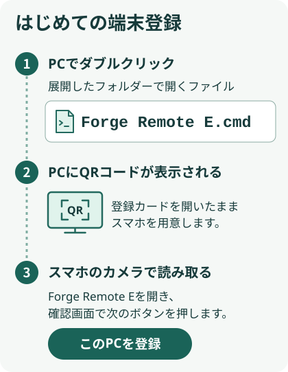
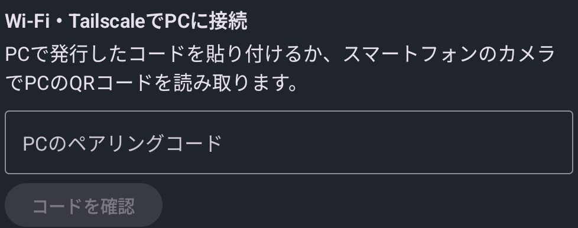
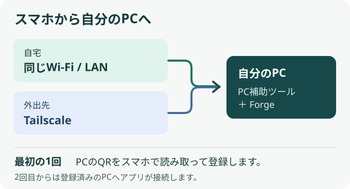
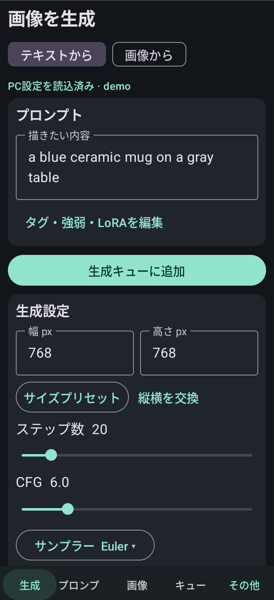
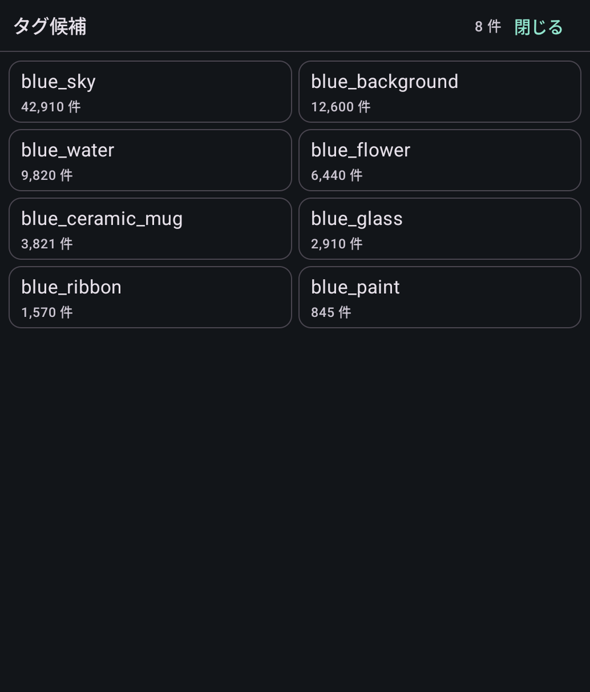
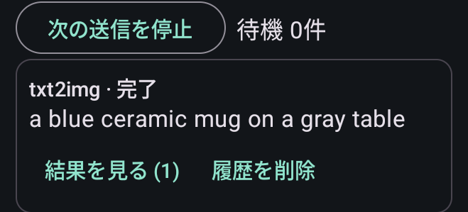

# Forge Remote E 1.0 操作ガイド

スマートフォンでプロンプトを入力し、いつも使っているPCのForgeで画像を生成できます。**初回だけPCとスマートフォンを登録**します。次からは自宅のWi-Fiでアプリを開くと、同じPCに再接続します。PCは有線LANでも、スマートフォンと同じ家庭内ネットワークにあれば利用できます。

## 1　PCとスマートフォンを準備する

1. GitHubのReleaseを開き、スマートフォンに **Forge-Remote-E-1.0.apk**、Windows PCに **Forge-Remote-E-PC-1.0.zip** をダウンロードします。Android 8.0以降が対象です。[Forge Remote E のダウンロード](https://github.com/asugonomi/Forge-Remote-E/releases/tag/v1.0)
2. スマートフォンでAPKを開いてインストールします。Androidが許可を求めた場合は、ダウンロードに使ったアプリからのインストールを許可します。
3. PCでZIPを展開し、Forgeをいつもの方法で起動します。ForgeのHTTP APIが無効なら、普段の起動オプションに `--api` を加えて再起動します。
4. 展開したフォルダーの **「Forge Remote E.cmd」** をダブルクリックします。Windowsで拡張子を隠しているときは **「Forge Remote E」** と表示されます。フォルダー選択画面が出たら、普段のForge本体が入っているフォルダーを選びます。
5. PCのブラウザーに登録用QRコードが開きます。アプリを使う間はForgeと補助ツールのウィンドウを開いておきます。スマホを登録したらQRのページは閉じて構いません。

ポートやPythonを個別指定している場合は、展開先のPowerShellから `.\Start-Network.ps1 -ForgeRoot 'D:\AI\Forge' -Pair` を使えます。Forgeのポートは `-ForgePort`、ForgeのPythonは `-Python 'D:\AI\python\python.exe'` で指定します。PC補助ツールはその環境の `cryptography` を使用します。

## 2　自宅のWi-Fiで初回登録する

1. スマートフォンを自宅のWi-Fiに接続し、標準カメラでPCの登録カードを読み取ります。開くアプリを聞かれたら **Forge Remote E** を選びます。
2. アプリにPC名と接続先が表示されます。自分のPCで発行したカードであることを確かめ、**「このPCを登録」** をタップします。
3. アプリの「接続」に **「接続済み · LAN」** と表示されたら、生成に進めます。縦画面では下の **「その他」→「接続」**、横に広い画面では上の **「接続」** から確認できます。

カメラからアプリが開かない場合は、PCの登録カードで文字列を表示し、アプリの「接続」→「PCのペアリングコード」に全文を貼り付けます。**「コードを確認」→「このPCを登録」** の順で進みます。コードは1台につき1回、15分間有効です。次回の接続ではQRの読み取りも、USB接続やワイヤレスデバッグの設定も不要です。

### 2台目のスマートフォンを追加する

PCで **「Forge Remote E.cmd」** をもう一度ダブルクリックします。新しく表示されたQRコードを、追加するスマートフォンで読み取ります。

端末を手放したときは、PCで `.\Start-Network.ps1 -ForgeRoot 'D:\AI\Forge' -ListDevices` を実行し、登録一覧で対象を確認します。`-ListDevices` を `-Revoke <端末ID>` に変えて実行すると、その端末の登録が無効になります。スマートフォンの「登録を解除」は、そのスマートフォンに保存した接続情報を消す操作です。

## 3　外出先からTailscaleで接続する

1. Windows PCとAndroidにTailscaleをインストールし、同じTailscaleネットワークに参加します。自分の端末だけなら、両方で同じアカウントにログインします。[Tailscale公式のセットアップ手順](https://tailscale.com/docs/how-to/quickstart)
2. PCのTailscaleを接続してからPC補助ツールを起動します。起動時に表示される接続先に、家庭内のアドレスとTailscaleの `100.x.x.x` のアドレスがあることを確認します。独自のTailscaleアクセス制御を使う場合は、スマートフォンからこのPCのTCP 17873（既定値）への通信を許可します。
3. **最初の登録時にTailscaleが未接続だった場合**は、生成が終わってからPC補助ツールを終了し、**「Forge Remote E.cmd」** をダブルクリックして起動し直します。新しいカードで同じPCをもう一度登録すると、端末に外出用の接続先も保存されます。
4. 外出時はPCのForge・補助ツール・Tailscaleを起動したままにします。AndroidでTailscaleを接続してForge Remote Eを開き、「接続」で **「接続済み · Tailscale」** を確認します。ルーターのポート開放は不要です。

## 4　画像を1枚生成する

1. **「生成」→「テキストから」** を選びます。初回はPCの生成設定を読み込みます。Animaを選択しているForgeでは、その環境から取得したプロンプトや数値が出発点です。
2. 「描きたい内容」を入力します。幅・高さは「生成設定」で直接入力するか、**「サイズプリセット」** から比率や固定解像度を選びます。「縦横を交換」で向きを変えられます。対応するAR-PlusPlusの設定をPCに置いている場合はその内容を読み込みます。
3. **「生成キューに追加」** をタップします。生成画像の上部に進捗が表示され、PCでライブプレビューが有効なら生成途中の画像も更新されます。
4. 縦画面で送信後の状況を見るには「キュー」を開きます。完了した行の **「結果を見る」** から画像を開きます。全画面表示もここから使えます。

元画像から生成するには **「画像から」→「画像を選択」** で端末の画像を開き、「変化の強さ」を調整してキューに追加します。PCの出力画像や過去のキューの結果を開いて **「img2imgに使う」** を選ぶこともできます。

## 5　タグ・重み・LoRAを編集する

- **タグ補完**　入力途中に普通のTag Autocomplete候補が表示されます。候補は辞書の使用件数順です。横に広い画面では生成画像の上、縦画面では入力欄と同じ画面に表示されます。候補をタップするとカーソル位置の語句が置き換わり、末尾に半角カンマと半角スペースが付きます。
- **タグの表記**　PCがアンダースコアを空白にし、括弧をエスケープする設定なら、候補 `red_cup_(object)` は `red cup \(object\), ` と入ります。そのまま次の語句を入力できます。PCの追加CSVは設定に従って読み込みます。スマートフォン用の語句は「プロンプト」→「タグを登録」で保存し、「端末のタグ」から再利用します。
- **強弱と順序**　「プロンプト」で正またはネガティブの語句を選び、「強く ＋0.1」「弱く −0.1」で調整します。**「並べ替え」→語句をタップ→同じ語句を指でドラッグ→「適用」** の順で移動します。移動中の語句が指に追従し、改行・空行ごとの並びを確認できます。「前へ」「次へ」でも移動できます。
- **LoRA**　「プロンプト」→ **「LoRA を挿入」** を開き、フォルダーや名前で絞り込みます。PCにプレビュー画像があればサムネイルで見分けられます。使うLoRAと重みを確かめて挿入してください。

## 6　キュー・画像・拡張を操作する

| やりたいこと | 操作 |
| --- | --- |
| 次に送る順を変える | 「キュー」の待機中の行で「順序」を長押しして上下にドラッグ。または「上へ」「下へ」。待機中の削除は「取り消す」。 |
| 次の送信を止める | 「次の送信を停止」をタップ。待機中のジョブを残したまま止まり、「キュー再開」で続けられます。 |
| 生成中の画像をスキップ・中断する | 下記のジョブ操作拡張をPCに追加します。スキップは現在の処理を飛ばし、中断はこのジョブの残りの生成を止めます。 |
| PCの過去画像を使う | 「画像」→「PC」→「日付を選ぶ」。出力フォルダーに日付があればその日付、それ以外は更新日で分類します。画像→「PNG Info」→「生成設定を復元」で条件を読み込めます。 |
| スマートフォンの画像を使う | 「画像」→「端末」→「画像を開く」または「フォルダーを選ぶ」。必要に応じて「PCでPNG Infoを確認」も選択できます。 |
| 大きく表示する | 生成結果・ギャラリー・img2imgの入力画像の全画面表示を開きます。広い画面は編集と生成結果を並べ、対応する折りたたみ端末ではヒンジを避けて配置します。 |
| ADetailerを設定する | 「拡張」でADetailerを選び、有効化して検出モデル、信頼度、マスク、インペイントなどを設定します。使える項目・モデルは接続先のADetailerに従います。 |
| その他の拡張を設定する | 「拡張」で名前を検索し、使いたい生成スクリプトを選びます。ForgeのAPIが公開するスイッチ・数値・文字列・選択肢に対応します。 |
| 自分の初期値を保存する | 「接続」→「生成の初期値と下書き」でモードを選び、「現在の内容を端末の初期値に保存」。正負のプロンプトと生成条件の下書きは自動保存され、次の起動で再開できます。 |

実行中のスキップと中断を使う場合は、PCで一度 `.\Install-JobControl.ps1 -ForgeRoot 'D:\AI\Forge'` を実行し、生成と待機列が空になってからForgeを再起動します。他の端末やPCから始めた生成は、この端末の操作対象に入りません。待機列を続けて送る間は、アプリを開いておいてください。

## つながらない・項目が出ないとき

| 状況 | 確認すること |
| --- | --- |
| 同じWi-FiでもPCが見えない | PCと端末が同じ家庭内ネットワークか、ゲストWi-Fiや端末間通信の分離を使っていないかを確認します。Windowsのファイアウォールで自宅のプライベートネットワークから補助ツールへの通信を許可します。 |
| 接続先候補が複数出る／PCのアドレスが変わった | PC補助ツールを必要に応じて `-LanAddress <PCの家庭内IPv4>` 付きで起動し直します。アプリが再発見できないときは `-Pair` で新しいカードを発行します。 |
| QRのページを閉じた／コードが期限切れ | PCで **「Forge Remote E.cmd」** をもう一度ダブルクリックし、新しく開いたQRを読み取ります。 |
| Forgeや辞書が見えない | PCのForgeが起動済みで `--api` が有効か、`-ForgeRoot` とポートが正しいかを確認します。別データフォルダーは `-DataRoot`、別の設定ファイルは `-Config`、LoRAの場所は `-LoraRoot` で指定できます。 |
| 使っている辞書と違う | Forgeで使用中のTag Autocompleteの辞書と追加CSV設定を確認します。互換拡張が複数ある場合は `-TagExtension <拡張フォルダー名>` を指定します。AR-PlusPlusの指定は `-ArExtension` です。 |
| 自宅で使えて外出時だけつながらない | PCと端末のTailscaleが接続中か、登録カードにTailscaleの接続先が含まれていたかを確認します。「3　外出先からTailscaleで接続する」の手順で更新できます。 |

Everyone版では、モデル・辞書・設定・出力画像は利用者自身の環境から読み込みます。P-H3 Imageの編集機能は一般配布版に含まれません。ブラウザー専用の拡張画面や、独自形式の引数を必要とする拡張には、個別対応が必要です。掲載した実機画面には説明用のプロンプトと辞書を使っています。

### 1.0での実機確認

家庭内Wi-Fiでは、Android実機で初回登録と再起動後の再接続を行い、PC画像の日付と枚数が実際の出力と一致することを確認しました。Tailscaleでも別のAndroid実機から登録済みPCに接続し、ギャラリーの日付と画像一覧の読み込みを確認しました。実画像の生成とキューの完了・結果表示はtxt2imgで確認しています。Tailscale経由での長時間生成や、利用者独自の拡張の全組み合わせは未検証です。
