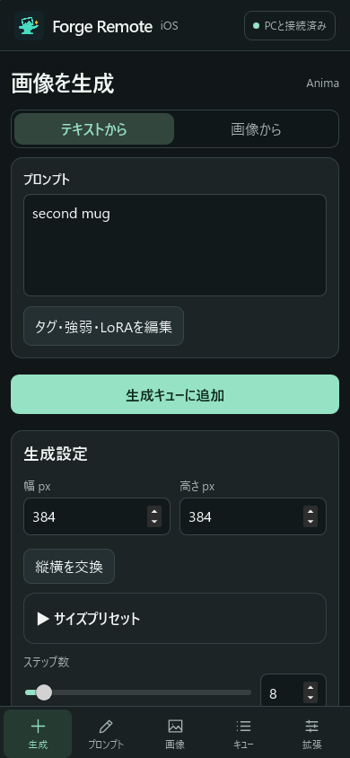
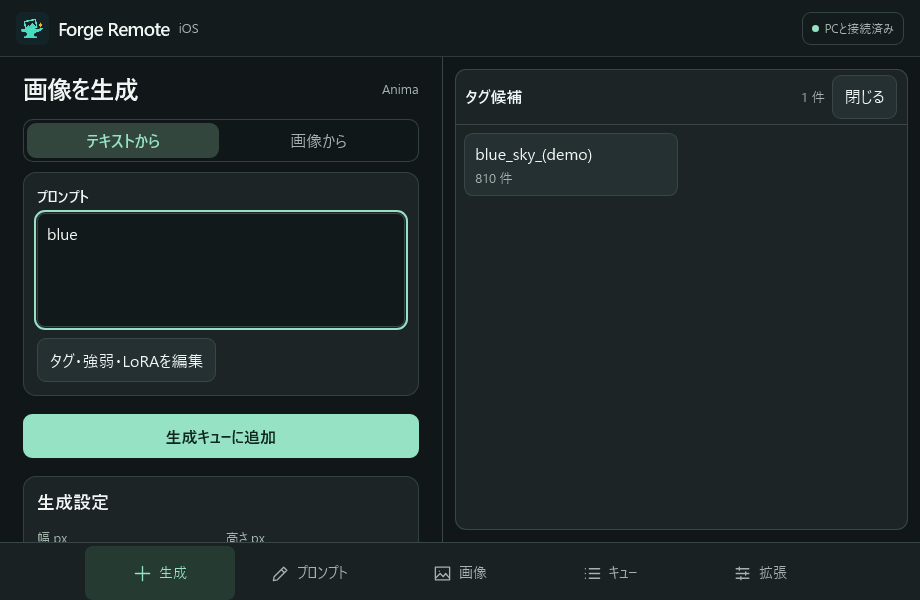

# Forge Remote iOS の使い方

自宅でも外出先でも、iPhoneのホーム画面に置いたアイコンから自分のPCのForgeを操作できます。生成はPCで行います。PCのForge・補助ツール・Tailscaleを起動したまま使います。

## 初めて接続する

1. PCにPC用ZIPを展開し、いつものForgeを起動します。ForgeのAPIを有効にしておきます。PCとiPhoneでTailscaleを開き、同じネットワークに接続します。[iPhone版Tailscaleの設定](https://tailscale.com/docs/install/ios)
2. PCで **「Forge Remote iOS.cmd」** をダブルクリックします。初回だけTailscaleのHTTPS利用許可を求められる場合があります。発行された証明書のホスト名は公開記録に載ります。Forgeへの接続は許可したTailscaleネットワーク内に限定されます。[Tailscale Serve](https://tailscale.com/docs/features/tailscale-serve)
3. PCに表示されたQRを **iPhoneのカメラ** で読み、リンクをSafariで開きます。「画像を生成」が表示されたら登録済みです。QRは1台・15分間有効です。新しい端末を追加するときは、PCで同じ起動ファイルをもう一度開きます。

### ホーム画面にアイコンを置く

Safariの **共有ボタン**（四角から上向きの矢印）→ **「ホーム画面に追加」** → **「追加」** をタップします。「Webアプリとして開く」の項目がある場合はオンにします。「ホーム画面に追加」が見えない場合は共有の一覧を下までスクロールします。次回からは **「Forge Remote」アイコン** をタップしてください。[Appleの案内](https://support.apple.com/ja-jp/guide/iphone/iphea86e5236/27/ios/27)

iOS 17.2以降では、ホーム画面への追加時にSafariの認証Cookieが引き継がれます。先にアイコンを作った場合など、アイコン側だけに登録画面が出るときは、PCで発行した新しいカードの「登録用リンクをコピー」を使い、アイコン側の「QRを読み取れないとき」に貼り付けて登録できます。別の登録として扱われるため、最初にSafariで登録してからアイコンを追加するのがおすすめです。[WebKitの認証情報の引き継ぎ](https://webkit.org/blog/14787/webkit-features-in-safari-17-2/)

## プロンプト・生成・キュー

| 操作 | 手順 |
| --- | --- |
| 生成 | 「生成」→「テキストから」または「画像から」。PCのプリセットを読み込みます。入力後に「生成キューに追加」をタップします。 |
| タグ補完 | 入力中の候補はPCの辞書の件数順です。候補をタップすると、PC設定に従った空白・括弧と、末尾の半角カンマ＋半角スペースが入ります。幅の広い画面では右側に候補が出ます。 |
| 語句の順序と重み | 「プロンプト」→「並べ替え」で語句をタップし、同じ語句を指でドラッグして適用します。改行・空行を保持します。強弱やLoRAのフォルダー検索・挿入もこの画面で行います。 |
| ロック中に生成 | PCがジョブを受け付け、「キュー」に表示されたらiPhoneをロックできます。PCが待機順に生成します。再びアイコンを開くと進捗と結果を取得します。 |
| キューを操作 | 待機中の行は「順序」をドラッグ、または「上へ」「下へ」で移動できます。「次の送信を停止」で後続を保留します。実行中のスキップ・中断はPCにジョブ操作拡張が必要です。 |
| 画像・設定を使い回す | 「画像」からPC出力の日付を選ぶか、iPhoneの写真・ファイルを選びます。元PNGに生成情報があれば「生成設定を復元」、「img2imgに使う」、全画面表示が使えます。 |
| ADetailer・拡張 | 「拡張」でモードを選び、利用するスロットや検出モデルなどを設定します。使える項目は接続先のForgeがAPIで公開する内容に従います。 |
| 下書き・初期値 | 正負プロンプトと生成条件は自動保存されます。右上の接続状態ボタンをタップすると、モード別の端末初期値を保存・復元できます。 |

画面例にはテスト用のプロンプトと辞書を使用しています。

## PC・端末を変更するとき

- **外出時**　PC側の3つのプログラムを起動したままにし、iPhoneのTailscaleをオンにして、いつものアイコンを開きます。
- **PCを再起動したとき**　Forgeを起動し、「Forge Remote iOS.cmd」を再度開きます。登録済みのアイコンをそのまま使えます。生成の途中でPC自体が停止したジョブは「要確認」になります。二重生成を防ぐため自動で送り直しません。
- **実行中のジョブを中断したいとき**　PCの既存ジョブ操作拡張が使えます。未導入の場合は同梱の `Install-JobControl.ps1 -ForgeRoot 'D:\AI\Forge'` で追加し、待機列が空のときにForgeを再起動してください。
- **QRを再表示したいとき**　PCで同じ起動ファイルをダブルクリックします。自宅と外出先で同じTailscale名を使います。ホスト名や配信ポートを変更した場合は、新しいQRとアイコンを登録してください。
- **登録端末と保存場所**　Web版の登録情報・生成キュー・結果はPCの `%LOCALAPPDATA%\ForgeRemoteE\Safari` にあります。キューの「履歴を削除」はこの端末のキュー内のコピーを削除します。PCのForge出力は別に保存されます。PCを共有する場合は、自分が信頼するWebサービスだけを同じTailscaleホスト名で運用してください。
